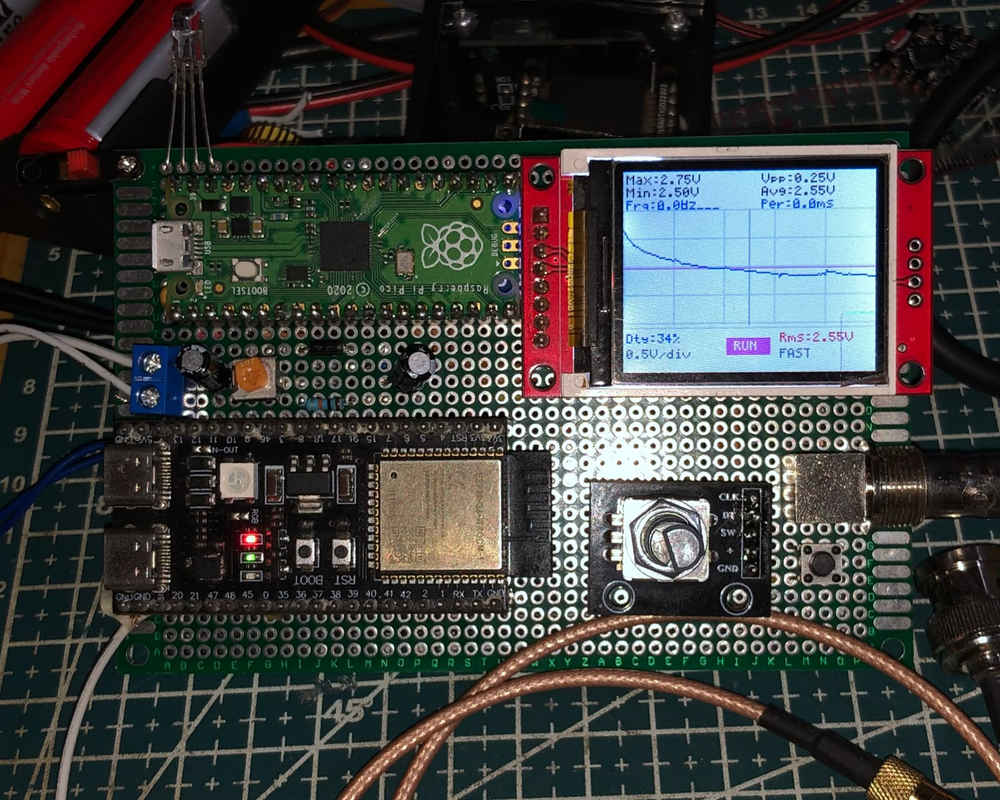
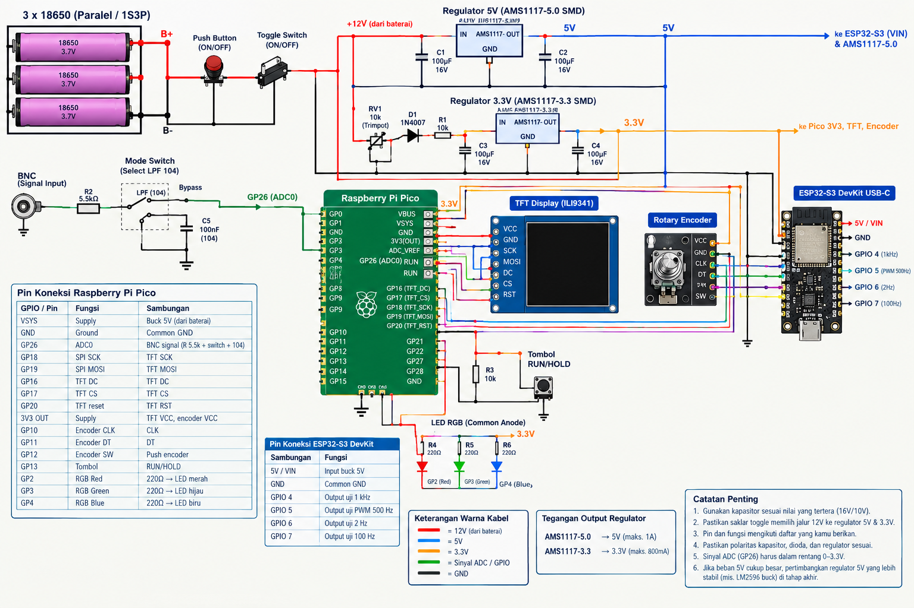
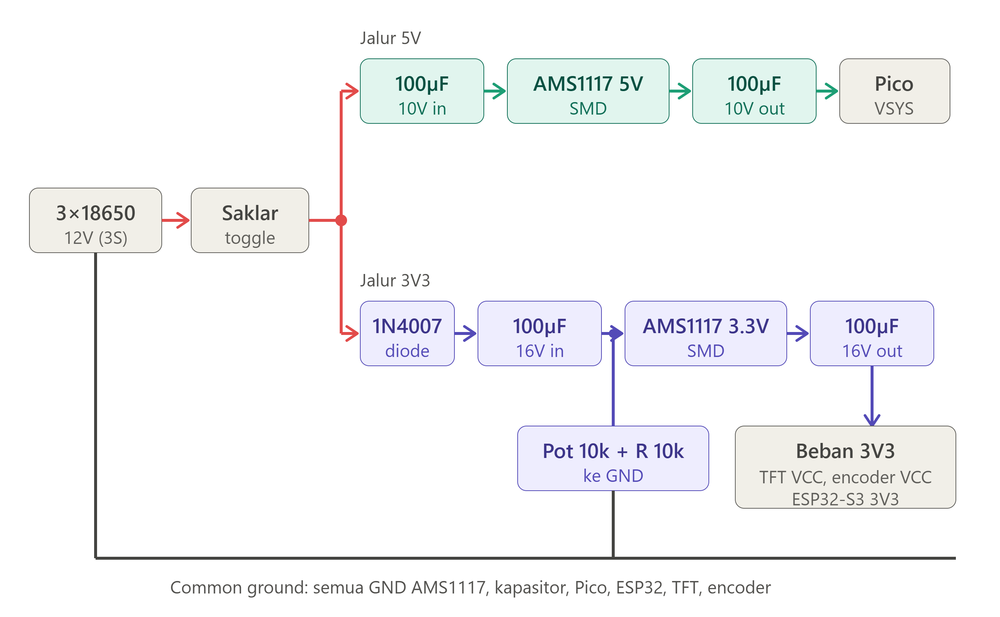
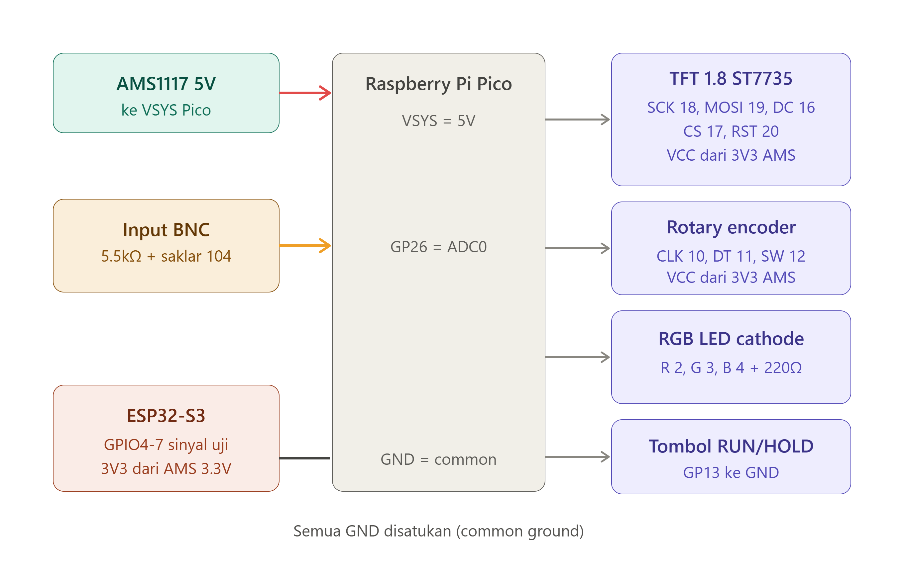
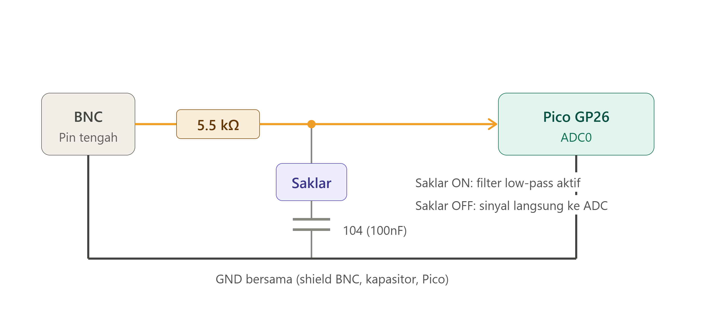
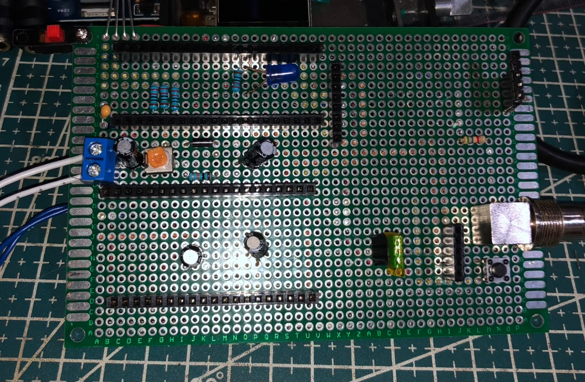
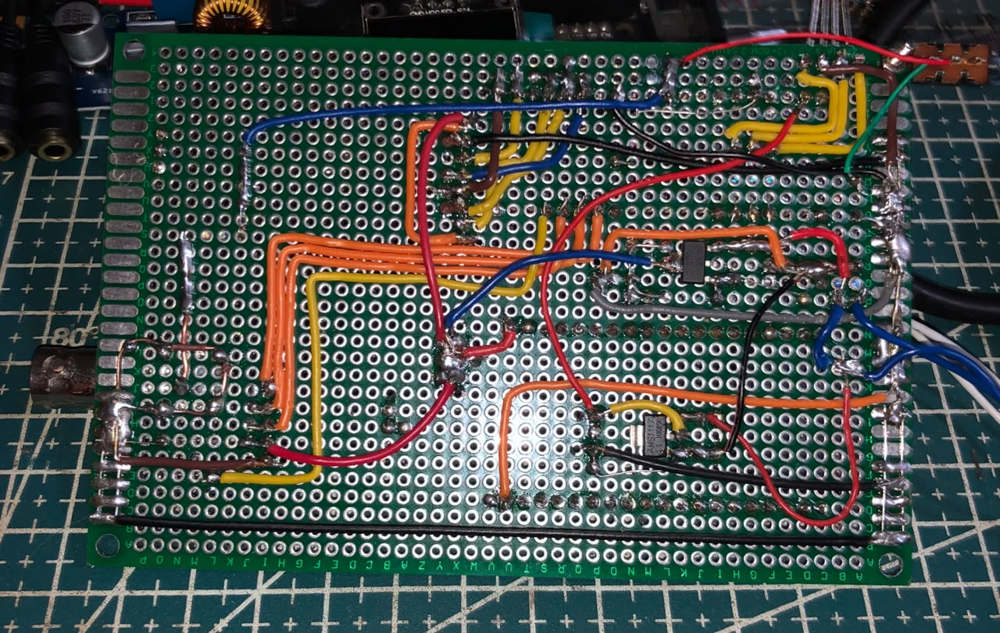

<h1 align="center">🔬 DIY PORTABLE MINI OSCILLOSCOPE</h1>

<p align="center">
  
</p>

<p align="center">
  <em>Osiloskop mini portabel berbasis Raspberry Pi Pico + ESP32-S3 Signal Generator</em>
</p>

<p align="center">
  
  
  
  
  
  
  
  
</p>

---

## 📑 Table of Contents

- [✨ Overview](#-overview)
- [🔧 Features](#-features)
- [🏗️ Hardware](#️-hardware)
- [📁 Project Structure](#-project-structure)
- [🔌 Wiring](#-wiring)
- [⚙️ Installation](#️-installation)
- [🎮 Controls](#-controls)
- [🧪 Testing](#-testing)
- [📷 Gallery](#-gallery)
- [⚠️ Catatan Penting](#️-catatan-penting)
- [📄 License](#-license)

---

## ✨ Overview

**Mini Osiloskop ESP32-S3 + Pico** adalah proyek osiloskop portabel sederhana yang menggunakan **Raspberry Pi Pico** sebagai unit utama (ADC + Display) dan **ESP32-S3** sebagai generator sinyal uji.

Proyek ini menampilkan gelombang real-time dari input BNC, dilengkapi pengukuran otomatis (Vmax, Vmin, Vpp, Avg, RMS, Frekuensi, Periode, Duty Cycle), serta mode tampilan **Wave** dan **Square**.

### 🎯 Tujuan Proyek
- Belajar akuisisi sinyal ADC dengan MicroPython
- Membuat osiloskop mini yang praktis dan portabel
- Menggunakan ESP32-S3 sebagai sumber sinyal uji yang stabil

---

## 🔧 Features

- ✅ **Real-time Waveform Display** pada layar ST7735 160×128
- ✅ **Pengukuran Otomatis**:
  - Max / Min / Vpp
  - Average & RMS
  - Frequency & Period
  - Duty Cycle
- ✅ **Mode Tampilan**: Wave (asli) dan Square (digital)
- ✅ **Timebase & V/div** dapat diatur via Rotary Encoder
- ✅ **RUN / HOLD** dengan push button
- ✅ **RGB LED** indikator status
- ✅ **Input BNC** dengan low-pass filter (switchable)
- ✅ **ESP32-S3 Signal Generator** built-in (1 kHz, 500 Hz PWM, 2 Hz, 100 Hz)

---

## 🏗️ Hardware

### Komponen Utama
| Komponen              | Keterangan                          |
|-----------------------|-------------------------------------|
| Raspberry Pi Pico     | Unit utama (ADC + Display)          |
| ESP32-S3              | Signal Generator                    |
| ST7735 1.8" TFT       | 160×128 RGB                         |
| Rotary Encoder        | Timebase + Mode                     |
| Push Button           | RUN / HOLD                          |
| RGB LED               | Indikator status                    |
| BNC Connector         | Input sinyal                        |
| AMS1117 3.3V          | Regulator                           |
| Baterai 3S (12V)      | Power supply                        |

### Power System
- Baterai 3 sel seri (≈12V)
- Diturunkan ke 3.3V menggunakan **AMS1117**
- Common Ground untuk seluruh sistem

---

## 📁 Project Structure

```text
miniosiloscop-esp32s3-pico/
├── 📄 README.md
├── 📁 assets/
│   ├── depan.jpeg
│   ├── depan-kosong.jpeg
│   ├── belakang.jpeg
│   ├── Skema-Elektronik-Lengkap-Pico-ESP32-S3.png
│   ├── skema_power_12v_ams1117.png
│   ├── wiring_esp32_sinyal_uji.png
│   ├── wiring_pin_pico_esp32.png
│   ├── wiring_power_komponen.png
│   └── input_bnc_lowpass_switch.png
├── 📁 pico/
│   └── micropython/
│       └── main.py                 # Kode utama Osiloskop
└── 📁 esp32s3/
    └── sketch.ino                  # Signal Generator
```

---

## 🔌 Wiring

### Skema Lengkap
<p align="center">
  
</p>

### Power (12V → 3.3V)
<p align="center">
  
</p>

### Wiring Pin Pico & ESP32-S3
<p align="center">
  
</p>

### Input BNC + Low-pass Switch
<p align="center">
  
</p>

**Penjelasan Input:**
- Sinyal BNC → Resistor 5.5kΩ → GPIO26 (ADC0)
- Kapasitor 104 (100nF) dapat dihubungkan/diputus ke GND melalui saklar (low-pass filter)

---

## ⚙️ Installation

### 1. Upload ke Raspberry Pi Pico
1. Install **MicroPython** di Pico
2. Salin file `pico/micropython/main.py` ke root Pico
3. Restart Pico

### 2. Upload ke ESP32-S3
1. Buka `esp32s3/sketch.ino` di Arduino IDE
2. Pilih board **ESP32-S3**
3. Upload sketch

### 3. Wiring
- Hubungkan semua sesuai diagram di folder `assets/`
- Pastikan **GND Pico** dan **GND ESP32-S3** tersambung

---

## 🎮 Controls

| Kontrol                  | Fungsi                              |
|--------------------------|-------------------------------------|
| **Putar Rotary Encoder** | Mengubah Timebase                   |
| **Tekan Rotary Encoder** | Ganti mode **Wave ↔ Square**        |
| **Push Button**          | **RUN / HOLD**                      |

### Mode Tampilan
- **Wave** → Menampilkan bentuk gelombang asli dari ADC
- **Square** → Tampilan digital (threshold)

---

## 🧪 Testing

Gunakan sinyal dari ESP32-S3:

| Pin ESP32-S3 | Sinyal              | Keterangan          |
|--------------|---------------------|---------------------|
| GPIO 4       | Square 1 kHz        | Sinyal cepat        |
| GPIO 5       | PWM 500 Hz (25%)    | Uji duty cycle      |
| GPIO 6       | Pulse 2 Hz          | Sinyal lambat       |
| GPIO 7       | Square 100 Hz       | Sinyal sedang       |

**Saran Timebase:**
- GPIO 4 (1 kHz) → Timebase `0` (FAST)
- GPIO 5 (500 Hz) → Timebase `0` atau `20`
- GPIO 6 (2 Hz) → Timebase `500` ~ `2000`
- GPIO 7 (100 Hz) → Timebase `50` ~ `100`

---

## 📷 Gallery

<p align="center">
  
  
</p>

<p align="center">
  
</p>

---

## ⚠️ Catatan Penting

- Input ADC Pico hanya menerima **0 – 3.3V**
- Jangan masukkan tegangan negatif atau > 3.3V
- Resistor 5.5kΩ berfungsi sebagai proteksi ringan
- Kapasitor 104 (jika diaktifkan) akan memfilter sinyal frekuensi tinggi
- Pengukuran frekuensi merupakan **estimasi** berdasarkan rising edge

---

## 📄 License

Proyek ini open source di bawah lisensi **MIT**.

---

<div align="center">
  <strong>📟 Mini Osiloskop ESP32-S3 + Raspberry Pi Pico</strong><br>
  Built with MicroPython • ST7735 • ESP32-S3
  <br><br>
  <a href="#top">⬆ Kembali ke Atas</a>
</div>
